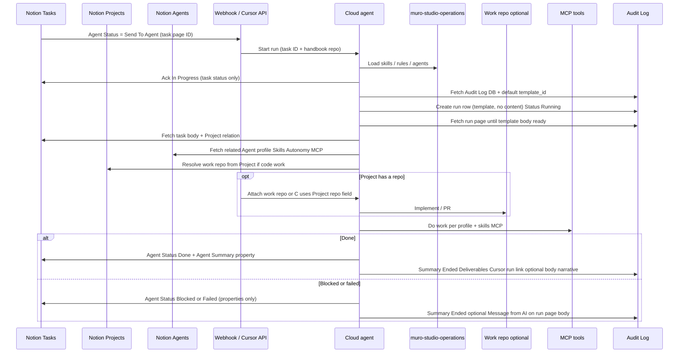

# Handoff sequence

Notion task → Cursor cloud agent → writeback. Agent identity is the **Agents page ID** (Tasks relation). This handbook repo is always attached. A **work repo** (when needed) comes from the task’s **Project**, not from the Agent profile.

Webhook payload stays thin (`notion_task_id`, handbook repo). Re-fetch task, Agent, and Project from Notion. Attach a work repo only when the Project (or task override) names one.